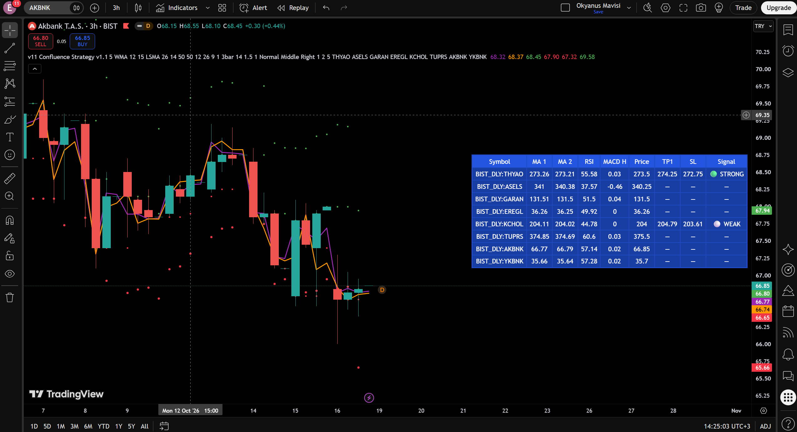
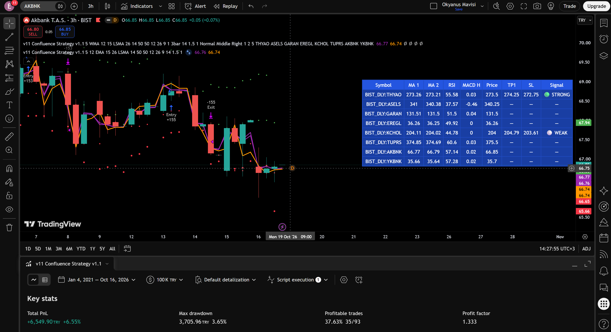

# Multi-Symbol MTF Confluence Scanner

> A Pine Script v6 indicator and trend-following strategy that scans 8 BIST symbols in real-time using MA, RSI, and MACD confluence. Built from a 15-year-old's idea, rebuilt at 20 as a proper quant research project.



## The Story

I first wrote this indicator at **15 years old** — a simple multi-symbol MA scanner (Pine v3/v4). At **20**, while working toward a career in quantitative development, I decided to rebuild it properly. 

Here is the journey:
1. **Refactored** the legacy code to idiomatic Pine v6.
2. **Discovered a critical bug** — the stop-loss was never executing due to a `var` state-reset issue, artificially inflating backtest results from a real PF of 0.27 to a fake 1.62.
3. **Evolved the logic** — replaced the redundant 4-MA crossover with a Confluence System (MA Crossover + RSI + MACD).
4. **Optimized exits** — proved that keeping a Take Profit (TP) ruins this specific trend-following logic. Removing TP increased the average Profit Factor from 0.71 to 1.08.

This repository documents the full journey — including the mistakes.

## What It Does

- Scans **8 BIST symbols** simultaneously in a single dashboard table.
- Computes **Confluence Signals**: MA Crossover + RSI (>50) + MACD Histogram (>0).
- Provides a **3-level signal strength**: 🟢 STRONG (3/3), 🟡 MEDIUM (2/3), ⚪ WEAK (1/3).
- Calculates dynamic **ATR-based Stop Loss (1.5 ATR)**.
- Uses **Hidden MTF Logic**: Takes 5m and 15m MAs but plots them on a 3H chart to catch short-term momentum within higher timeframe trends.
- Built-in **TradingView Alerts** for real-time signals.

## Backtest Results (v1.0)

**Test Parameters:**
- **Date Range:** Jan 2021 – Oct 2026
- **Initial Capital:** 100,000 TRY
- **Commission:** 0.15% | **Slippage:** 2 ticks
- **Configuration:** 3H Chart, MA1: 5m(12 EMA), MA2: 15m(26 EMA), Strict Mode (3/3), SL: 1.5 ATR.

**Exit Logic Comparison (Profit Factor):**

| Symbol | Test A (No TP, SL Only) | Test B (TP 1R) | Test C (TP 2R) |
|---|---|---|---|
| ASELS | **1.06** | 0.44 | 0.52 |
| THYAO | **1.61** | 0.65 | 0.95 |
| GARAN | 0.95 | 0.77 | 0.89 |
| KCHOL | 0.89 | 0.99 | 0.84 |
| AKBNK | 0.87 | 0.69 | 0.69 |
| **Average** | **1.08** | **0.71** | **0.78** |

**Key Finding:** This is a **trend-following** strategy. Taking profit early cuts the winners and destroys the edge. Exits must be handled solely by the ATR Stop Loss or Reverse Signals.



## The Bug That Changed Everything
Early versions showed a fake PF of 1.62. Once I fixed a state-reset bug (where the Stop Loss was cleared before the trade even opened), the real PF was 0.27. You can read the full technical breakdown here: [docs/bug-discovery.md](docs/bug-discovery.md).

## Limitations
To maintain scientific honesty, I must note:
- **In-Sample Only:** The strategy hasn't been validated on an out-of-sample dataset yet.
- **Low Trade Count:** 93 trades is statistically borderline. Longer testing is required.
- **Single Market:** Only tested on BIST equities.

## File Structure
```text
multi-symbol-mtf-scanner/
├── README.md
├── LICENSE
├── src/
│   ├── scanner_v11.pine       # Main Indicator (Dashboard)
│   └── strategy_v1.1.pine     # Backtest Strategy
├── docs/
│   └── bug-discovery.md       # Technical breakdown of the state-reset bug
└── screenshots/
    ├── dashboard.png
    └── backtest.png

How to Use
Copy the code from src/scanner_v11.pine (Indicator) or src/strategy_v1.1.pine (Strategy).

Paste into TradingView Pine Editor and save.

Add to chart. Recommended chart TF: 3 Hours.

Leave the default MA TFs: MA1 = 5m, MA2 = 15m.

In Strategy Settings: Set Strict Mode = ON, Enable Take Profit = OFF.

Note: The indicator uses 12 request.security calls (8 symbols + 4 MAs), which fits comfortably within TradingView's free plan limits.

Roadmap
☑ v1.0: Confluence Scanner (Current)
□ v2.0: True Multi-Timeframe (MTF) logic (e.g., 1H entry, 4H trend)
□ v3.0: Python Cross-Validation (yfinance + pandas) & Streamlit Dashboard
License
Mozilla Public License 2.0 — see LICENSE.

About
Efekan Ömer Fidan
Aspiring Quant Developer / Investment Analyst · Turkey
LinkedIn · GitHub
